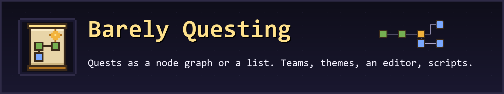

# Barely Questing



An in-game quest book for Minecraft, in the Barely family. Chapters of quests, shown as a pannable node graph or as a list, with tasks, rewards, teams, resource-pack themes, an in-game editor, importers for FTB Quests and Better Questing, and scripting through ModJS and KubeJS.

Forge and NeoForge on Minecraft 1.20.1, 1.21.1, 26.1.2, 26.2 and 26.3: ten builds, one jar each (`barelyquesting-<loader>-mc<version>-<mod version>.jar`). Version `2026.11.1`.

Docs: [itmecasey.com/wiki/barelyquesting](https://itmecasey.com/wiki/barelyquesting/) (source in [wiki/](wiki/)).

## What it does

- **Quests:** chapters of quests with a title, rich-text description, icon, position, dependencies, tasks, rewards and locks (other quests, a time window, or a script condition). Two views of the same data: a node graph with dependency lines, and a list with checkboxes.
- **Tasks:** item (hold or hand in, with tag and item-data matching), craft, obtain, kill, advancement, statistic, location, dimension, biome, structure, checkmark, and scripted.
- **Rewards:** items, XP (points or levels) and commands, claimed by the player in the book, given to the player or to the whole team once.
- **Teams:** everyone has their own progress; players can form teams that share it. The server owns all progress and syncs it to the clients.
- **Themes:** a theme is JSON plus textures in a resource pack (colors, nine-slice panels and buttons, node sprites, font, sounds). F3+T reloads it. Two ship with the mod: Default and Parchment.
- **Editor:** drag nodes, add and link quests, edit every field, pick items from a searchable list, undo and redo. Edits apply to everyone online at once and are saved as files. Permission gated: operators, creative players, or names on the editor list.
- **Storage:** readable JSON under `config/barelyquesting/` (`book.json` and one file per chapter in `chapters/`), so it diffs and hand-edits well. Progress is per world.
- **Player UI:** the J key or the craftable Quest Book item opens the book; a HUD tracker shows pinned quests; toasts and sounds follow the theme; `/barelyquesting` (alias `/bq`) has `open`, `edit`, `reload`, `complete`, `reset`, `import` and `editor`.
- **Scripting:** ModJS and KubeJS scripts can create chapters and quests, add task, reward and lock types, listen for quest events and complete quests. See [docs/scripting.md](docs/scripting.md). Both are optional.
- **Recipe viewers:** left click a quest item for its recipes, right click for its uses, in JEI, REI, EMI or BEI where they are installed; Ctrl+J over any item opens the quest that mentions it. See [docs/integrations.md](docs/integrations.md).
- **Importers:** `/barelyquesting import <folder or file>` converts an FTB Quests folder or a Better Questing `DefaultQuests` folder once. There is no runtime dependency on either mod.

## Install

Put the jar for your loader and Minecraft version in `mods/`. The mod is needed on the server and on every client. No other mod is required.

## Build

Each Minecraft version and loader is its own Gradle build (`neoforge-26.1.2/`, `forge-1.21.1/`, ...). Shared code lives in `common/` (no Minecraft types; unit tested), per-version calls in `version-<mc>/`.

```
scripts/build_all.sh            build and unit-test all ten, collect the jars in dist/
python scripts/server_check.py all    headless dedicated-server self test for all ten (a real player, the engine, commands)
```

Layout and decisions are in [PLAN.md](PLAN.md); what is checked and what is not is in [docs/COMPATIBILITY.md](docs/COMPATIBILITY.md) and [PROJECT_STATUS.md](PROJECT_STATUS.md).

## License

MIT, see [LICENSE](LICENSE).
