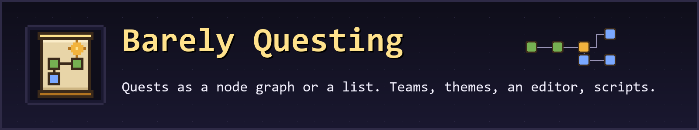
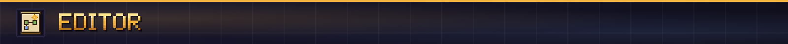

**An in-game quest book for Forge and NeoForge: a node graph or a list, tasks and rewards, teams, themes, an editor and scripting.**

Barely Questing gives your pack a guide. Quests sit in chapters, and every chapter can be read as a pannable node graph with dependency lines or as a checklist. Players claim rewards in the book, play solo or share progress in a team, and pick a look from the resource-pack themes. Pack makers edit the whole book in game, import an existing FTB Quests or Better Questing book once, or build quests with ModJS and KubeJS scripts.

Docs: [itmecasey.com/wiki/barelyquesting](https://itmecasey.com/wiki/barelyquesting/)

- **Two views, one book:** a node graph (pan, zoom, dependency lines) and a list grouped by status with search.
- **Tasks:** items (hold or hand in, tags and item data), craft, obtain, kill, advancement, statistic, location, dimension, biome, structure, checkmark and scripted.
- **Rewards:** items, XP and commands, claimed in the book, for the player or once for the whole team.
- **Teams:** per-player progress by default; players create, invite, join and leave teams that share progress. The server owns everything.
- **Locks:** other quests, a time window or a script condition.
- **Player extras:** J opens the book, a HUD tracker follows pinned quests, themed toasts and sounds, and `/barelyquesting` commands.
- **Recipe viewers:** click a quest item for its recipes (left) or uses (right) in JEI, REI, EMI or BEI.

A theme is a JSON file and some textures in a resource pack: colors, nine-slice panels, buttons and node sprites, a font and sounds. F3+T reloads it. Default and Parchment ship with the mod, and anyone can add more.

Turn on Edit in the book (operators, creative players and names on the editor list): drag nodes, add and link quests, edit every field with an item picker, undo and redo. Changes reach everyone online at once and are saved as readable JSON under `config/barelyquesting/`, one file per chapter, so they diff and hand-edit well. `/barelyquesting import` converts an FTB Quests folder or a Better Questing `DefaultQuests` folder.

With ModJS or KubeJS installed, scripts get a `BarelyQuesting` object: create chapters and quests, register task, reward and lock types, listen for `questStarted`, `taskProgressed`, `questCompleted` and `questClaimed`, and complete quests. Neither is required.

**Does it need FTB Quests or Better Questing?** No. It can import their books once and has no runtime link to them.

**Where are my quests?** `config/barelyquesting/book.json` and `config/barelyquesting/chapters/*.json`. Progress is saved with the world.

**Source and issues:** [github.com/ItMeCasey/BarelyQuesting](https://github.com/ItMeCasey/BarelyQuesting)
